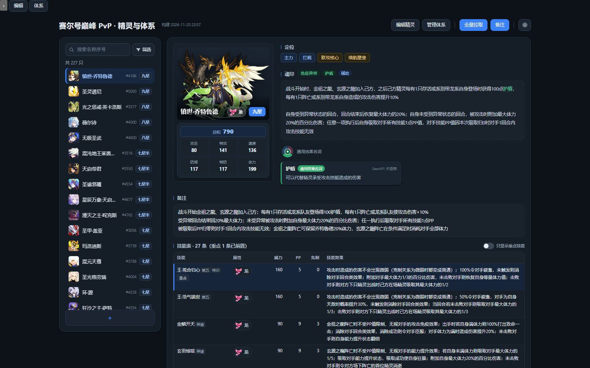
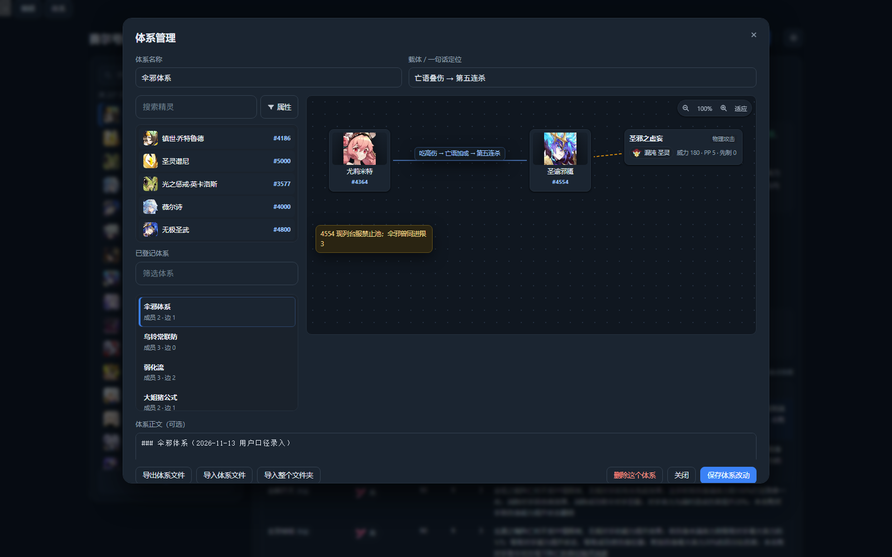
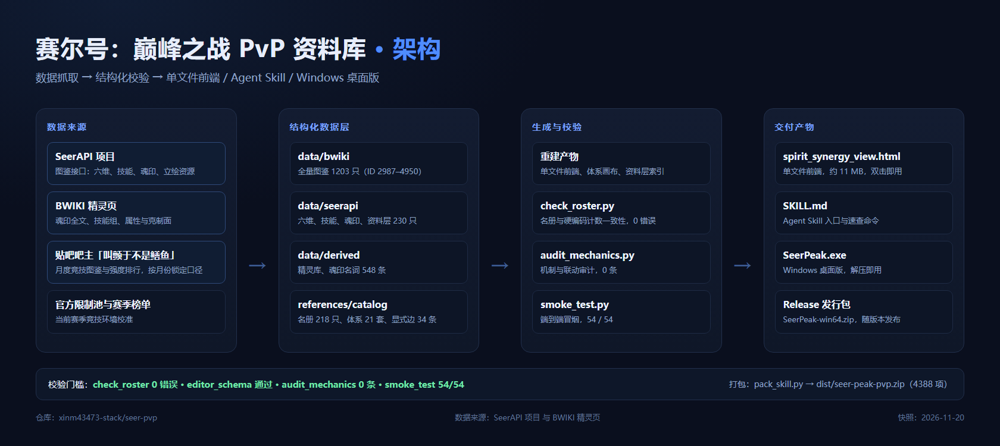

# 赛尔号：巅峰之战 PvP 精灵资料库

> 218 只深研精灵 · 1203 只全量图鉴 · 21 套体系关系 · 单文件网页前端 + Windows 桌面版



## 简介

这是一个面向《赛尔号：巅峰之战》PvP 的本地精灵资料与战术知识库，同时打包为可离线运行的单文件网页前端、Windows 桌面程序和 Agent Skill。

- **精灵图鉴**：218 只深研精灵，按九星到四星共 10 档分级，含立绘、定位、魂印全文、六维种族值、技能表、备注与战术链。
- **全量资料**：全量图鉴覆盖 ID 2987–4950 共 1203 只精灵（魂印、六维、技能、克制面），另有 1977 只隐藏精灵库作为添加来源。
- **体系画布**：21 套已登记体系、34 条显式联动边、24 条双向互证联动声明，用画布展示精灵之间的出场顺序与联动条件。
- **完全离线**：前端是单个 HTML 文件（约 11 MB），数据全部内联，双击即可打开，不依赖服务器与网络。
- **可编辑**：内置编辑器，可修改精灵资料、备注、技能与体系，支持导出/导入体系文件。
- **桌面版**：Windows 桌面程序（exe），双击启动，同一份前端也可用浏览器直接打开。

## 界面预览

### 精灵详情

左侧是精灵列表，可按名称、序号搜索；右侧依次是立绘与定位、魂印全文、通用效果名词解释、备注、技能表。


### 体系画布

在「体系」中打开体系管理，选择已登记体系即可看到节点、连线、技能卡与备注，支持缩放与拖拽。



### 整体架构



## 下载与使用

### Windows 桌面版

1. 打开 [Releases 页面](https://github.com/xinm43473-stack/seer-pvp/releases/latest)，下载 `SeerPeak-win64.zip`（约 96 MB）。
2. 解压到任意目录。
3. 双击 `SeerPeak.exe` 启动。

> 仓库 `release/` 目录下存有同一份发行包，可作镜像下载；也可直接用命令行拉取：
> ```text
> https://github.com/xinm43473-stack/seer-pvp/releases/download/v1.0.0/SeerPeak-win64.zip
> ```

解压后的目录结构：

```text
SeerPeak/
├── SeerPeak.exe      # 启动入口
└── _internal/        # 运行时、前端页面与图片资源，勿删
```

运行环境：Windows 10 / 11（64 位），需要 WebView2 运行时（Windows 11 已内置，Windows 10 通常随 Edge 安装）。程序启动后会在本机随机端口启动一个只读静态服务，仅监听 `127.0.0.1`，不联网。

### 网页版

前端是单文件 HTML，构建后在 `references/spirit_synergy_view.html`，用浏览器直接打开即可。图片资源按相对路径读取 `assets/`，若本地缺失会回退到 SeerAPI 静态资源仓库的在线地址。

## 功能说明

| 功能 | 说明 |
|---|---|
| 搜索与筛选 | 按名称、外号、序号搜索；按档位、定位、魂印标签筛选 |
| 魂印全文 | 以 BWIKI 全文为准，本地快照截断时以全文层覆盖；同一精灵取 id 最大的最新魂印 |
| 通用效果名词 | 魂印中的专有名词（护盾、免疫异常、续航壁垒等）附 SeerAPI 术语表释义 |
| 技能表 | 属性、威力、PP、先制、效果，可只看重点技能 |
| 备注 | 人工撰写的战术定位、操作链、失效条件与对局提示 |
| 体系画布 | 节点、连线、技能卡、备注，支持拖拽与缩放，可新建与编辑体系 |
| 编辑器 | 编辑精灵、定位、魂印、备注、技能，支持导出体系 JSON |
| 全量拉取 | 从 SeerAPI 拉取最新魂印与种族值，写入覆盖层，不破坏人工数据 |
| 主题 | 深色 / 浅色主题，跟随系统并记忆选择 |

## 仓库结构

```text
seer-pvp/
├── SKILL.md                    # Agent Skill 入口：速查表、命令与证据规则
├── HANDOVER.md                 # 开发交接文档：现状、约定、变更记录
├── data/
│   ├── bwiki/                  # BWIKI 全量图鉴：精灵、魂印、克制表
│   ├── seerapi/                # SeerAPI 数据：六维、技能、魂印、资料
│   └── derived/                # 派生数据：精灵库、魂印名词
├── references/
│   ├── catalog/                # 结构化目录：名册、体系、索引、审计结果
│   ├── docs/                   # 机制与战术文档：别名、筛选、战术、来源
│   ├── systems/                # 21 套体系正文（JSON）
│   └── spirit_synergy_view.html # 构建产物：单文件前端
├── scripts/                    # Python 数据构建、抓取、校验脚本
├── desktop/
│   ├── exe/                    # Windows 桌面版：启动器与打包脚本
│   └── tools/                  # 构建工具链安装脚本
├── release/                    # 发行包：SeerPeak-win64.zip
└── docs/images/                # 本文档用图
```

## 本地构建

### 环境

- Python 3.10 及以上
- 构建桌面版需要 `pywebview` 与 `pyinstaller`，可用脚本一键安装：`pwsh desktop/tools/install_toolchain.ps1`

### 重建前端

```powershell
python scripts\rebuild_view.py
```

生成 `references/spirit_synergy_view.html`（内联全部数据）。

### 打包 Windows 桌面版

```powershell
pwsh desktop\exe\build_exe.ps1
```

产物在 `dist/desktop/SeerPeak/`。打包脚本会自动探测工具链目录（`D:\ruanjianmen\dabao\venv-exe`、`E:\seerskill\.buildtools\venv-exe` 或项目内 `.buildtools\venv-exe`）。

### 校验（提交前必须全绿）

```powershell
python scripts\check_roster.py      # 名册与硬编码计数一致性，要求 0 ERROR
python scripts\editor_schema.py     # 编辑器数据 schema 不变量
python scripts\audit_mechanics.py   # 机制与联动审计，要求 0 条
python scripts\smoke_test.py        # 端到端冒烟，要求 54/54
```

## 数据与统计

| 项 | 数值 |
|---|---|
| 深研精灵 | 218 只（九星 2／八星 3／七星半 5／七星 10／六星半 38／六星 41／五星半 55／五星 37／四星 19／特殊 8） |
| 全量图鉴 | 1203 只（ID 2987–4950） |
| 隐藏精灵库 | 1977 只，仅作添加来源 |
| 体系／显式边／联动声明 | 21 / 34 / 24 |
| 资料层 | 230 只 |
| 魂印标签 | 1595 条 |
| 种族值 | 4951 条 |
| 魂印名词 | 548 条 |

数据来源为 **SeerAPI 开源项目**与 **BWIKI 精灵页**：图鉴、魂印全文、六维、技能与克制面均取自这两处。精灵的强度分级参考百度贴吧吧主「叫颤于不是鳝鱼」的月度竞技图鉴与强度排行，并用官方限制池与赛季榜单校准。收录以可复核的图鉴原文与实战记录为准，不以魂印条数或自动评分判断；详细口径见 `SKILL.md` 与 `references/docs/`。

## 免责声明

本项目为非官方的玩家自建资料库，仅用于学习、研究与交流。精灵名称、形象、技能与魂印文本等游戏内容版权归原权利人所有。数据可能存在滞后或误差，战术结论不构成对战强度承诺，请以游戏内实际内容为准。
